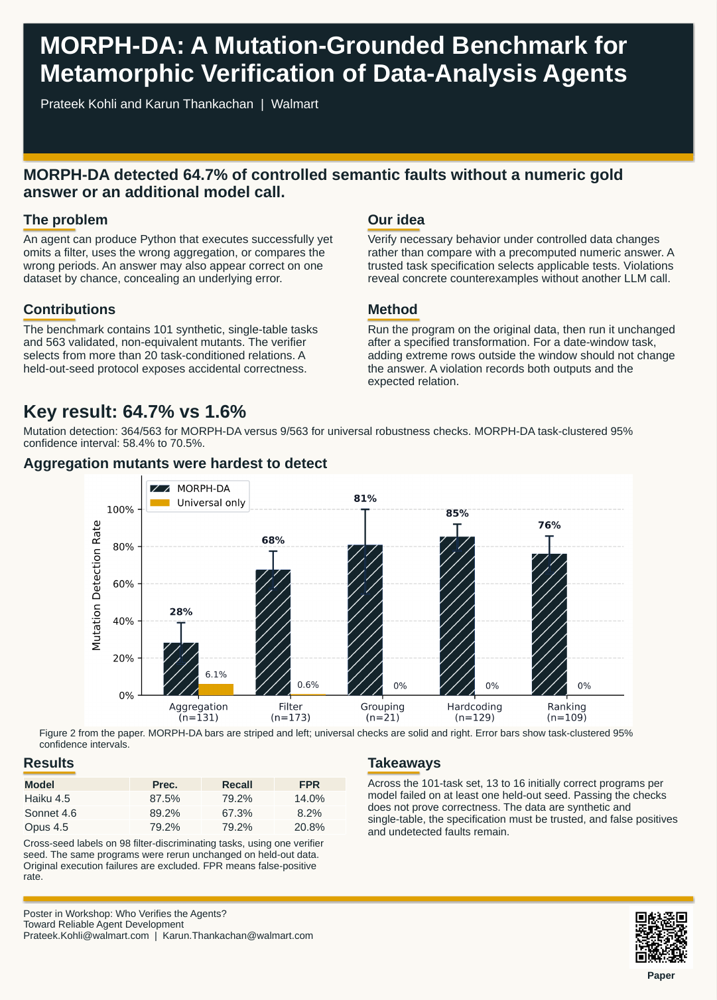

<div align="center">

# MORPH-DA

### A Mutation-Grounded Benchmark for Metamorphic Verification of Data-Analysis Agents

Prateek Kohli and Karun Thankachan (Walmart)
NeurIPS 2026 Workshop *Who Verifies the Agents? Toward Reliable Agent Development*

[**Paper**](paper/morphda_paper.pdf) · [**Poster**](paper/morphda_poster.pdf) · [**OpenReview**](https://openreview.net/forum?id=JsrKw3nUSV) · [**Replicate**](#replicate-step-by-step)

[](paper/morphda_poster.pdf)

</div>

**MORPH-DA is an open benchmark and verifier for LLM data-analysis agents.** It combines
metamorphic testing and mutation testing to catch wrong filters, wrong aggregations and wrong
time periods in agent-written Python/pandas analysis code — without a numeric gold answer and
without an additional model call. Use it to evaluate data-science agents, test agent-generated
analysis code, measure verifier quality with seeded faults, and detect answers that are only
correct by chance.

---

## The problem

An agent can produce Python that executes successfully yet omits a filter, uses the wrong
aggregation, or compares the wrong periods. An answer may also look correct on one dataset by
chance, concealing an underlying error.

## Our idea

Verify *necessary behavior under controlled data changes* instead of comparing with a
precomputed numeric answer. A trusted task specification selects which tests apply. A violation
yields a concrete counterexample.

## Method

Run the program on the original data, then run it **unchanged** after a specified transformation.
For a date-window task, adding extreme rows outside the window must not change the answer. A
violation records both outputs and the relation that failed.

```
task spec ──► applicable relations ──► transform tables ──► re-run the same program ──► compare
                                                                      └─ violation = counterexample (both outputs + relation)
```

## Contributions

- **Benchmark:** 101 synthetic, single-table tasks over 8 scenarios, with deterministic data per
  `(scenario, seed)` and a reference program per task.
- **Mutant corpus:** AST mutants of the reference programs in five fault families — aggregation,
  filter, grouping, hardcoding, ranking — generated by 30 mutation operators.
- **Verifier:** task-conditioned metamorphic relations (31 in this code base) in eight families:
  Universal, Filter/Scope, Aggregation, Grouping, Time, Statistics, Joins, Hardcoding.
- **Held-out-seed protocol:** re-running a program unchanged on other data seeds exposes
  *accidental corrects* — answers that are right on one seed by chance.
- **Agent harness:** a question-to-program agent with hosted-model and local-model backends,
  plus a one-step repair study.

## Key result

Universal robustness checks (row/column order, duplication) catch almost none of the injected
faults. The task-conditioned relations catch most of them, and the filter/scope and aggregation
families account for the bulk. On programs written by hosted models, the verifier flags most
wrong programs at a low false-positive rate, and the held-out-seed protocol shows that a
meaningful share of initially correct programs are accidental corrects. See the poster above for
the figures and tables.

## Takeaways

Passing the checks is evidence, not a proof of correctness. The data are synthetic and
single-table, the specification must be trusted, and false positives and undetected faults remain.

---

## FAQ

**What is metamorphic testing for data-analysis agents?**
Instead of comparing an agent's answer with a stored number, you change the input data in a way
whose effect on the answer is known (add rows outside a date window, shuffle rows, duplicate a
period) and check that the same program's output obeys that relation. MORPH-DA ships 31 such
relations and a task specification that selects the ones that apply.

**How do I evaluate an LLM data-analysis agent without gold answers?**
Run `scripts/run_natural_agents.py` to generate programs, then `scripts/run_verification.py` and
`scripts/evaluate_natural_agents.py` to verify them. Gold answers are only used to label programs
when you want precision and recall; verification itself needs none.

**How do I measure how good a verifier or test suite is?**
Mutation testing: the benchmark includes a corpus of seeded faults (wrong aggregation, missing
filter, wrong grouping, hardcoded constant, wrong ranking) and reports how many each verifier
catches. Add your own verifier alongside the three in `scripts/run_verification.py`.

**What are accidental corrects?**
Programs that give the right answer on one dataset by chance and fail when run unchanged on other
data seeds. The held-out-seed protocol finds them.

**Does it work for text-to-SQL / NL2SQL agents?**
The tasks, relations and executor in this repository target Python/pandas programs; SQL is not
executed. The underlying idea — re-run the same query or program on transformed tables and
check necessary output relations — also appears in metamorphic testing of text-to-SQL systems
(see below). Porting it to SQL means adding a SQL executor and SQL-specific mutation operators.

**Can I run it with a local model?**
Yes. `--provider ollama` runs any Ollama model with no API key and no data leaving your machine.

## Related work

MORPH-DA builds on, and is compared with, benchmarks and methods for data-analysis agents
(InfiAgent-DABench, DS-1000, DSCodeBench, DataSciBench, DS-STAR), metamorphic testing of
text-to-SQL systems (MT-Teql) and of language models (LLMORPH), and mutation testing. Full
references are in the [paper](paper/morphda_paper.pdf).

---

## Replicate step by step

### 0. Prerequisites

- Python ≥ 3.11 and `git`
- Access to a Python package index (`MORPHDA_INDEX_URL` overrides PyPI)
- **For step 5 only:** either an Anthropic API key (hosted models) or a local
  [Ollama](https://ollama.com) server (no key, nothing leaves your machine)

### 1. Install and self-test

```bash
git clone https://github.com/prateekkohli2018-ampba/morphda.git && cd morphda
bash scripts/setup.sh              # creates .venv, installs everything, runs the tests
source .venv/bin/activate
```

Options: `--skip-tests`, `--ollama-model NAME` (also pulls a local model).

### 2. Build the benchmark

```bash
morphda info                       # 101 tasks, 8 scenarios, 31 relations, 30 mutation operators
morphda validate                   # every reference program passes all relations on seeds 42/7/123
python scripts/export_benchmark.py # plain files: specs, questions, gold answers, CSV tables
```

`export_benchmark.py` writes `benchmark/export/{task_specs,questions.jsonl,gold,data}` for any
set of `--seeds`.

### 3. Build the mutant corpus (optional — a frozen corpus is included)

```bash
python scripts/generate_rule_mutants.py   # -> benchmark/frozen_mutants/rulemut_corpus.jsonl
```

This **overwrites** the frozen corpus. Skip it to use the shipped one.

### 4. Score the verifier on the mutants

```bash
python scripts/run_verification.py --workers 8   # universal / filter+aggregation / full MORPH-DA
python scripts/make_paper_figures.py             # kill matrix + detection curve -> paper/figures/*.csv
python scripts/make_result_tables.py             # per-family tables -> paper/result_tables.txt
```

Writes `runs/verification/results.jsonl` (one row per mutant with the verifiers that killed it)
and `summary.txt`. Takes a few minutes with 8 workers.

### 5. Run an agent

```bash
# Hosted model
export ANTHROPIC_API_KEY=...
python scripts/run_natural_agents.py --model claude-haiku-4-5

# Local model (Ollama)
ollama pull gemma4:e4b
python scripts/run_natural_agents.py --provider ollama --model gemma4:e4b --sample 12
```

- The agent sees only the question and a schema summary; programs are generated on data seed 42.
- `--sample N` takes a deterministic sample spread over difficulty levels and scenarios.
- Providers: `--provider anthropic|ollama` or `MORPH_DA_PROVIDER`. A custom Anthropic-compatible
  endpoint: set `MORPH_DA_API_URL` (https only) and `MORPH_DA_API_KEY`.
- Output: `runs/natural_agents/<model>/programs.jsonl`.

### 6. Evaluate it

```bash
python scripts/evaluate_natural_agents.py runs/natural_agents/gemma4_e4b
```

Re-executes each program **unchanged** on held-out seeds 7 and 123 (programs wrong on either are
accidental corrects), then reports precision / recall / FPR / F1 / accepted-answer risk for
Condition A (naive labels), B (cross-seed labels) and C (two verifier seeds), restricted to the 98
scope-discriminating tasks. Writes `evaluation_rows.jsonl` and `evaluation_summary.json` next to
the programs.

The three frozen hosted-model runs are included, so you can recompute their evaluation with no API
access:

```bash
python scripts/evaluate_natural_agents.py runs/natural_agents/claude_haiku_4_5 \
    runs/natural_agents/claude_sonnet_4_6 runs/natural_agents/claude_opus_4_5
```

### 7. Repair study (optional)

```bash
python scripts/run_repair.py --provider ollama --model gemma4:e4b \
    --programs-file runs/natural_agents/gemma4_e4b/programs.jsonl \
    --verification-file runs/natural_agents/gemma4_e4b/verification.jsonl
```

### Expected output

| Command | Expected |
|---|---|
| `morphda info` | 101 tasks, 8 scenarios, 31 relations, 30 mutation operators |
| `morphda validate` | every reference program passes on seeds 42 / 7 / 123 |
| `evaluate_natural_agents.py` on the frozen runs | execution failures 2 / 0 / 2 (Haiku / Sonnet / Opus); correct on seed 42 → accidental corrects 59→16, 62→13, 61→13 |

Results are deterministic for a given corpus and data seed; bootstrap intervals vary in the last
decimal. Outputs of your own runs go under `runs/` and are not tracked by git.

Dataset notes:

- The shipped corpus `rulemut_corpus.jsonl` has 563 rows, of which 398 are distinct (165 exact
  duplicates from a re-run that appended to the file); `generate_rule_mutants.py` overwrites
  instead of appending.
- The marketplace scenario uses the column `order_value` and the fulfillment value `platform`.

**Safety:** `execute_program` runs generated code in the current process with a timeout and
resource limits — it is not a security sandbox. Run agent-written code in a container or VM if
you do not trust the model.

---

## Use the verifier on your own program

```python
from morphda.data.generators import generate_scenario
from morphda.relations import ALL_RELATIONS
from morphda.tasks.factory import generate_task_set
from morphda.verification.engine import VerificationEngine

task   = generate_task_set()[5]
tables = generate_scenario(task.scenario_id, seed=42)
report = VerificationEngine(ALL_RELATIONS).verify(program_source, tables, task)
print(report.decision)    # "pass" | "fail" | "error"
print(report.witnesses)   # counterexamples when it fails
```

`program_source` is a string defining `analyze(tables)`, where `tables` is a dict of DataFrames.

## Relation families

| Family | Relations | Detects |
|---|---|---|
| Universal | MR-U* | row/column-order dependence |
| Filter/Scope | MR-F* | missing filters, wrong date bounds, AND→OR |
| Aggregation | MR-A* | sum↔mean, count↔distinct, wrong denominator |
| Grouping | MR-G* | wrong grouping dimension, hardcoded labels |
| Time | MR-T* | period swap, absolute vs relative change, date window |
| Statistics / Joins / Hardcoding | MR-S*, MR-J*, MR-H* | translation invariance, join errors, constants |

## Repository layout

```
morphda/      package: tasks, data generators, reference compiler, relations, mutations,
              verification engine, sandbox, evaluation, agents (anthropic, ollama), repair
scripts/      setup.sh, export_benchmark.py, generate_rule_mutants.py, run_verification.py,
              run_natural_agents.py, evaluate_natural_agents.py, run_repair.py, ...
benchmark/    frozen mutant corpus (+ export target)
runs/         frozen agent programs and evaluation outputs
tests/        pytest suite (`pytest -q`)
paper/        paper and poster (PDF)
```

## Topics

data-analysis agents · LLM agents · agent evaluation · agent verification · metamorphic testing ·
mutation testing · LLM-as-analyst · data science agents · pandas code generation · text-to-SQL /
NL2SQL (related) · benchmark · reproducible research · Ollama · NeurIPS 2026 workshop

## Citation

```bibtex
@inproceedings{kohli2026morphda,
  title     = {{MORPH}-{DA}: A Mutation-Grounded Benchmark for Metamorphic Verification of Data-Analysis Agents},
  author    = {Prateek Kohli and Karun Thankachan},
  booktitle = {NeurIPS 2026 Workshop Who Verifies the Agents? Toward Reliable Agent Development},
  year      = {2026},
  url       = {https://openreview.net/forum?id=JsrKw3nUSV}
}
```

GitHub's "Cite this repository" button reads [`CITATION.cff`](CITATION.cff); the BibTeX entry is also in [`CITATION.bib`](CITATION.bib). Licensed under the
[MIT License](LICENSE).
